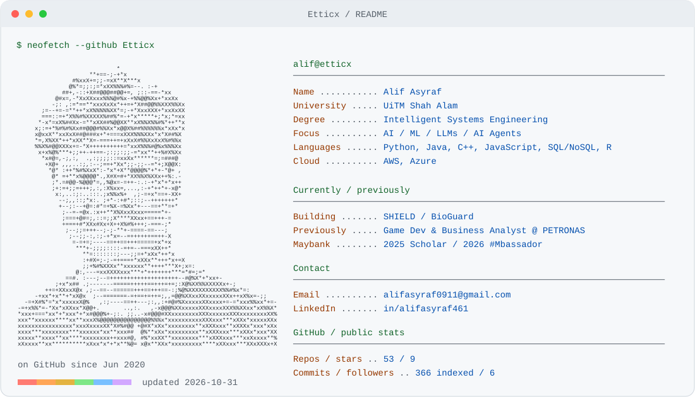
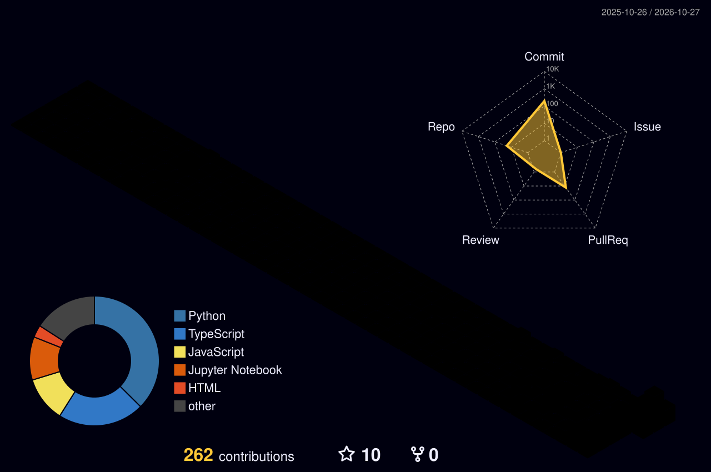

  <a href="https://github.com/Etticx">
    <picture>
      <source media="(prefers-color-scheme: dark)" srcset="./profile/dark.svg" />
      
    </picture>
  </a>

### currently building

- SME Health Indicator and Evaluator for Loan Decision (SHIELD) that utilises Random Forest with SHapley Additive exPlanation (SHAP) translated with LLM for interpretability
- BioGuard, a Computer Vision app that identifies specific invasive plants and connect photo reports to ecological review, work orders, and restoration follow-Up, this focuses primarily on township areas.

### stats, because why not^^

  
 
<i>currently probably fixing a bug I introduced ten minutes ago</i>

  <picture>
    <source
      media="(prefers-color-scheme: dark)"
      srcset="https://raw.githubusercontent.com/Etticx/Etticx/output/bomberman-contribution-graph-dark.svg"
    />
    <source
      media="(prefers-color-scheme: light)"
      srcset="https://raw.githubusercontent.com/Etticx/Etticx/output/bomberman-contribution-graph.svg"
    />
    
  </picture>

  

